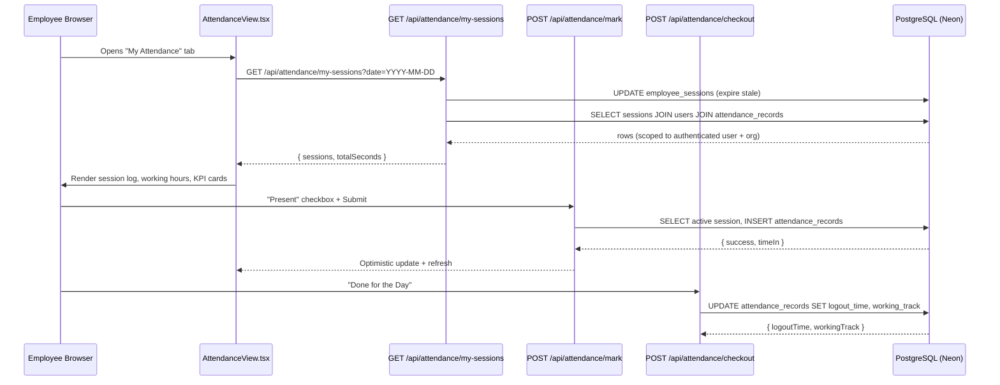
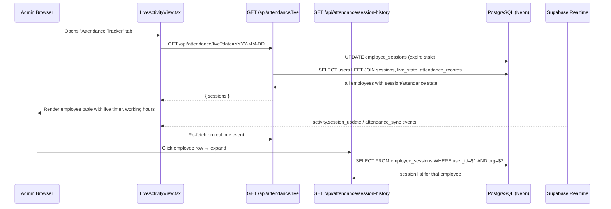

# Attendance Architecture Audit

**Date:** 2026-10-23
**Scope:** Attendance Tracker (admin) + My Attendance (employee)
**Phase:** Read-only investigation — no code changes made

---

## A. Executive Summary

| Area | Status |
|------|--------|
| Attendance Tracker (admin) | **Partially Working** — live tracking, session list, punctuality, risk all functional; Working Hours column fixed in prior session (fallback to session timestamps when `working_track` is null) |
| My Attendance (employee) | **Partially Working** — session log, attendance marking, cumulative timer functional; Working Hours column fixed in prior session; some role gaps in `my-sessions` |
| Attendance Data Integrity | **Medium Risk** — two separate tables (`employee_sessions` vs `attendance_records`) serve different purposes; no cron for session expiration; lazy cleanup only |
| Security & Configuration | **High Risk** — `/api/diagnostic` is unauthenticated; `POST /api/settings/working-hours` allows any role to change org-wide shift; `.env.local` contains production credentials with `ALLOW_PROD_DB_IN_DEV=1` |

### Top Five Findings

1. **CRITICAL — `/api/diagnostic` has NO authentication** and queries `attendance_records` plus `information_schema` with no tenant scope. Any HTTP client can call it.
2. **HIGH — `POST /api/settings/working-hours` uses `requireSession()` (any authenticated user)**, not `requireRole(["admin"])`. A receptionist or caller can change the org-wide shift timing.
3. **HIGH — `/api/attendance/session-history` accepts `userId` from query params** and is accessible to 6 roles including `receptionist`. Any authenticated user in those roles can read any other employee's full session history (within the same tenant). This is an intra-tenant IDOR.
4. **HIGH — `/api/debug-attendance` returns `allToday` (all employees' attendance records)** to any of 11 roles. The endpoint is a debugging leftover that exposes cross-employee data.
5. **MEDIUM — No server-side session expiration cron.** Expired sessions are only cleaned up lazily when an admin loads Live Activity or a user loads My Attendance. If neither happens, stale `is_active=true` rows persist indefinitely.

---

## B. Architecture Map

### Data Flow: My Attendance (Employee)



### Data Flow: Attendance Tracker (Admin)



### Session Lifecycle

```
LOGIN ──► INSERT employee_sessions (is_active=true, session_start=NOW())
  │
  ├──► HEARTBEAT every 30s ──► UPDATE last_heartbeat = NOW()
  │       │
  │       └── If is_active=false in DB ──► Return 401 ──► Client force-logout
  │
  ├──► MANUAL LOGOUT ──► UPDATE is_active=false, session_end=NOW()
  │
  ├──► FORCE LOGOUT (admin) ──► UPDATE is_active=false, session_end=NOW()
  │
  └──► HEARTBEAT TIMEOUT (>300s since last_heartbeat)
          Triggered lazily by GET /attendance/live or /my-sessions
          ──► UPDATE is_active=false, session_end=last_heartbeat
```

---

## C. Component and API Inventory

### Frontend Components

| Component | File | Purpose | Auth |
|-----------|------|---------|------|
| LiveActivityView | `frontend/src/app/dashboard/LiveActivityView.tsx` | Admin attendance tracker with employee table, live timer, analytics | Rendered only for `isAdmin \|\| isSiteHead` in `dashboard/page.tsx:1478` |
| AttendanceView | `frontend/src/components/AttendanceView.tsx` | Employee self-service attendance with session log | Available to all dashboard roles via nav config |
| AttendanceTimerWidget | `frontend/src/components/AttendanceTimerWidget.tsx` | Header widget showing login time + cumulative timer | Any authenticated user |
| LoginTimerWidget | `frontend/src/components/LoginTimerWidget.tsx` | Compact header login time + elapsed | Any authenticated user |
| AttendanceReportButton | `frontend/src/components/AttendanceReportButton.tsx` | Excel export button for admin | Backend enforces `admin`/`hr` |
| AttendanceContext | `frontend/src/components/AttendanceContext.tsx` | Shared context provider for attendance status badge | Any authenticated user |
| useShiftTiming | `frontend/src/hooks/useShiftTiming.ts` | Polls org shift config every 5 min | Any authenticated user |
| usePresenceRefresh | `frontend/src/hooks/usePresenceRefresh.ts` | Supabase realtime subscription for presence events | Org-scoped via channel |
| attendanceWorkbook | `frontend/src/lib/attendanceWorkbook.ts` | Excel workbook builder for attendance report | N/A (library) |

### API Endpoints

| Endpoint | Method | Roles | User ID Source | Org-Scoped | Tables |
|----------|--------|-------|----------------|------------|--------|
| `/api/attendance/mark` | POST | 11 roles | Server (session) | Yes | employee_sessions, attendance_records |
| `/api/attendance/checkout` | POST | 11 roles | Server (session) | Yes | attendance_records |
| `/api/attendance/heartbeat` | POST | 6 roles | Server (session) | Yes | employee_sessions, employee_live_state |
| `/api/attendance/status` | GET | 11 roles | Server (session) | Yes | attendance_records |
| `/api/attendance/my-sessions` | GET | 6 roles | Server (session) | Yes | employee_sessions, users, attendance_records |
| `/api/attendance/live` | GET | admin, super_admin, site_head | N/A (all users) | Yes | employee_sessions, users, employee_live_state, attendance_records |
| `/api/attendance/session-history` | GET | 6 roles | **Query param** | Yes | employee_sessions |
| `/api/attendance/force-logout` | POST | admin, super_admin, site_head | **Request body** | Yes | employee_sessions |
| `/api/attendance/analytics` | GET | admin, site_head, sales_manager | **Query param** | Yes | employee_activity_logs |
| `/api/attendance/advanced-analytics` | GET | admin, sales_manager, site_head | **Query param** | Yes | employee_activity_logs, employee_sessions |
| `/api/attendance/log-activity` | POST | 7 roles | Server (session) | Yes | employee_activity_logs, employee_live_state |
| `/api/attendance/report` | GET | admin, hr | N/A (all employees) | Yes | Multiple (7 tables) |
| `/api/auth/login` | POST | None (public) | Credentials | Yes | users, employee_sessions |
| `/api/auth/logout` | POST | Session | Server (session) | Yes | users, employee_sessions |
| `/api/hr/dashboard` | GET | admin, hr | N/A (aggregate) | Yes | Multiple |
| `/api/hr/employees/[id]/attendance` | GET | admin, hr | **URL param** (verified) | Yes | Multiple |
| `/api/settings/working-hours` | GET | **Any session** | N/A | Yes | organization_settings |
| `/api/settings/working-hours` | POST | **Any session** | N/A | Yes | organization_settings |
| `/api/settings/sessions` | GET/DELETE | Session | Server (session) | Yes | employee_sessions |
| `/api/debug-attendance` | GET | 11 roles | Server (session) | Yes | attendance_records |
| `/api/diagnostic` | GET | **None** | N/A | **No** | attendance_records, information_schema |

### Dashboard Page Integration

| Dashboard | File | Attendance View | Live Activity | Role Gate |
|-----------|------|-----------------|---------------|-----------|
| Admin | `dashboard/page.tsx:1450-1456` | AttendanceView (via nav `attendance`) | LiveActivityView (via nav `live_activity`, gated `isAdmin \|\| isSiteHead`) | Frontend + backend |
| Sales | `dashboard/sales/page.tsx:1116-1122` | AttendanceView | Not available | Backend only |
| Receptionist | `dashboard/receptionist/page.tsx:4502-4508` | AttendanceView | Not available | Backend only |
| HR | `dashboard/hr/page.tsx` | Via HR dashboard charts | Via HR dashboard | Backend `admin`/`hr` |

---

## D. Database Mapping

### `employee_sessions`

| Column | Type | Purpose | Notes |
|--------|------|---------|-------|
| id | SERIAL PK | Session identifier | |
| user_id | INTEGER FK→users | Employee | |
| session_start | TIMESTAMP | Login time | Naive on local; should be TIMESTAMPTZ on Neon |
| session_end | TIMESTAMP | Logout/expiry time | NULL while active; set to `last_heartbeat` on timeout, `NOW()` on manual logout |
| last_heartbeat | TIMESTAMP | Most recent heartbeat | Updated every 30s by client |
| is_active | BOOLEAN | Live session flag | Set `false` on logout/expiry |
| ip_address | VARCHAR(45) | Client IP | |
| device_info | VARCHAR(255) | User-Agent string | |
| login_device_name | VARCHAR(100) | Parsed device name | Migration: `2026-08-31_login_device_fields.sql` |
| login_device_type | VARCHAR(20) | desktop/mobile/tablet | Same migration |
| login_os | VARCHAR(50) | Operating system | Same migration |
| login_browser | VARCHAR(50) | Browser name | Same migration |
| login_latitude | DOUBLE PRECISION | GPS lat | Migration: `2026-08-31_login_location.sql` |
| login_longitude | DOUBLE PRECISION | GPS lon | Same migration |
| login_location_name | VARCHAR(255) | Reverse-geocoded | Migration: `2026-08-31_login_location_name.sql` |
| login_location_accuracy | DOUBLE PRECISION | GPS accuracy meters | Migration: `2026-08-31_login_location_accuracy.sql` |
| session_end_reason | VARCHAR(50) | logout/forced/expired | Migration: `2026-08-18_neon_full_schema_sync.sql` |
| organization_id | UUID | Tenant isolation | Inherited from user row at INSERT |
| created_at | TIMESTAMP | Row creation | |

**Indexes:** `employee_sessions_user_active_idx (user_id, is_active)`, `employee_sessions_stale_idx (last_heartbeat) WHERE is_active = true`

### `attendance_records`

| Column | Type | Purpose | Notes |
|--------|------|---------|-------|
| id | SERIAL PK | Record identifier | |
| organization_id | INTEGER/UUID | Tenant isolation | INTEGER locally (default 1), UUID on Neon |
| employee_id | INTEGER FK→users | Employee | |
| login_session_id | INTEGER FK→employee_sessions | Links to session | UNIQUE constraint |
| attendance_status | VARCHAR(20) | Present/Absent | |
| login_time | TIMESTAMP | Mark-attendance time | Deliberately naive for IST wall-clock |
| logout_time | TIMESTAMP | Checkout time | Set by `/api/attendance/checkout` |
| working_track | INTEGER | Seconds worked | `EXTRACT(EPOCH FROM (CURRENT_TIMESTAMP - login_time))` at checkout |
| submitted_at | TIMESTAMP | Submission time | |
| created_at | TIMESTAMP | Row creation | |

**Indexes:** `attendance_records_employee_day_idx (employee_id, DATE(login_time))`, `idx_attendance_records_org (organization_id)`

**Key relationship:** One attendance_records row per employee per day (anchored by `ORDER BY id ASC LIMIT 1`). Multiple employee_sessions rows per day are normal (re-login cycles).

### `employee_live_state`

| Column | Type | Purpose | Notes |
|--------|------|---------|-------|
| user_id | INTEGER PK FK→users | Employee | One row per user (upserted) |
| current_module | VARCHAR(100) | Active CRM module | |
| active_lead_id | VARCHAR(50) | Current lead | |
| active_lead_name | VARCHAR(100) | Lead name | |
| current_action | VARCHAR(255) | What user is doing | |
| current_route | TEXT | Full route path | |
| last_activity | TIMESTAMP | Last heartbeat snapshot | |
| idle_duration_seconds | INTEGER | Idle accumulator | |
| productivity_score | INTEGER | Computed metric | |
| is_idle | BOOLEAN | Idle flag | |
| organization_id | UUID | Tenant isolation | On Neon |

### Relationship Summary

```
users ──┬── employee_sessions (1:N per day, via user_id)
        │       │
        │       └── attendance_records.login_session_id (1:1, via UNIQUE)
        │
        ├── attendance_records (1:1 per day, via employee_id, ORDER BY id ASC)
        │
        └── employee_live_state (1:1, via user_id PK)
```

### Schema Drift (Local vs Neon)

The `db_schema_dump.txt` represents the local database state, which is behind Neon production:

| Feature | Local | Neon (ep-long-cloud) |
|---------|-------|------|
| organization_id type | INTEGER | UUID (converted) |
| Device/location columns | Missing from dump | Applied (login verified with location in screenshot) |
| working_track column | Missing from dump | Applied (checkout writes it) |
| Timestamp types | Naive TIMESTAMP | Likely TIMESTAMPTZ (original migration) |

The local `db_schema_dump.txt` is stale and should not be trusted for schema verification. Production (Neon) schema was verified via HR Phase 2 validation migration (`2026-10-17`).

---

## E. Feature Status Matrix

| Feature | Status | Evidence |
|---------|--------|----------|
| Employee login tracking | **Working** | Login creates `employee_sessions` row with all metadata |
| Attendance marking | **Working** | POST `/api/attendance/mark` creates `attendance_records` row, idempotent |
| Logout timestamp persistence | **Working** | Manual logout: `session_end = NOW()`. Heartbeat timeout: `session_end = last_heartbeat`. Both paths confirmed |
| Active session timer (Live Timer) | **Working** | `LiveActivityView:744` computes from `session_start` to `now`. `AttendanceView:228-237` does same. 1-second tick via `setInterval` |
| Completed session duration | **Working** | Computed from `session_start` to `session_end` in both views |
| Working Hours column (admin) | **Working** (fixed) | `LiveActivityView:750-766` — prefers `working_track`, falls back to `session_working_seconds`, then client-side computation |
| Working Hours column (employee) | **Working** (fixed) | `AttendanceView:649-675` — prefers `attendance_working_track`, falls back to session duration |
| Attendance Tracker employee list | **Working** | `/api/attendance/live` returns all org employees with session state |
| My Attendance personal history | **Working** | `/api/attendance/my-sessions` returns user's own sessions, server-side scoped |
| Role restrictions (admin view) | **Working** | Backend: `requireRole(["admin", "super_admin", "site_head"])`. Frontend: `isAdmin \|\| isSiteHead` gate at `dashboard/page.tsx:1478` |
| Employee data isolation | **Partially Working** | Self-service endpoints derive user_id server-side. But `/api/attendance/session-history` accepts `userId` from query param — intra-tenant IDOR |
| Date filtering | **Working** | IST-aware: `DATE(session_start AT TIME ZONE 'Asia/Kolkata') = $1`. Date picker bounded to today |
| Shift and punctuality logic | **Working** | `useShiftTiming` fetches org config. Punctuality badge computes diff from configured login time. Flexible mode supported |
| Export functionality | **Working** | `AttendanceReportButton` → `/api/attendance/report` → `attendanceWorkbook.ts` generates 3-sheet Excel. Admin/HR restricted |
| Session expiration | **Partially Working** | 5-minute heartbeat timeout works but is lazy (no cron). Runs only on `/attendance/live` or `/my-sessions` GET |
| Realtime updates | **Working** | LiveActivityView subscribes to Supabase Realtime channel for `session_update`, `attendance_sync`, `force_logout` events |
| Error handling | **Partially Working** | API routes have try/catch with 500 responses. Frontend has silent error swallowing in `fetchSessions()` catch blocks |
| API/environment configuration | **Partially Working** | All required vars present in `.env.local`. `ALLOW_PROD_DB_IN_DEV=1` enables production writes from dev machine |
| Payroll data dependencies | **Working** | `payrollEngine.ts` reads `COUNT(DISTINCT DATE(login_time))` from `attendance_records` — presence-based, not duration-based. Does NOT use `working_track` |

---

## F. Working-Hours Root Cause

### Prior State (Before Fix Applied in Earlier Session)

The Working Hours column showed `—` (dash) for all employees because:

1. **`working_track`** in `attendance_records` is **only populated by the explicit checkout endpoint** (`POST /api/attendance/checkout`, line 106). It computes `EXTRACT(EPOCH FROM (CURRENT_TIMESTAMP - login_time))::integer` at checkout time.

2. **If the employee never clicked "Done for the Day"**, `working_track` remained `null`. This includes sessions auto-expired by heartbeat timeout — the timeout sets `session_end = last_heartbeat` on `employee_sessions`, but **never touches** `attendance_records.working_track`.

3. **Both views checked `working_track != null`** and showed `—` when null:
   - `LiveActivityView.tsx:752`: `s.working_track != null ? ... : <span>—</span>`
   - `AttendanceView.tsx:650`: `s.attendance_working_track != null ? ... : <span>—</span>`

4. A `getWorkingHours()` function already existed in `LiveActivityView.tsx:101-109` that correctly computed duration from session timestamps, but **was never used** in the Working Hours column — only in the expanded history accordion.

### Fix Applied

The fix (applied in the prior session) adds a cascade of fallbacks:

1. **Backend** (`/api/attendance/live/route.ts`): Added `session_working_seconds` computed column — computes `EXTRACT(EPOCH FROM (session_end - session_start))` or `EXTRACT(EPOCH FROM (NOW() - session_start))` for active sessions, only when `working_track` is null.

2. **Frontend** (both views): When `working_track` / `attendance_working_track` is null, falls back to computing from `session_start` and `session_end` (or `now` for active sessions).

3. **Result**: Working Hours now shows for all sessions — checkout-based value when available, session-based fallback otherwise. Active sessions show live-updating duration.

### Remaining Concern

The two values may differ:
- `working_track` = `CURRENT_TIMESTAMP - login_time` (attendance record's login_time, i.e., when attendance was marked)
- Session fallback = `session_end - session_start` (employee session timestamps)

These differ when the employee marks attendance at a different time than the session starts, or when the employee has multiple sessions. The business should decide which is authoritative. Currently the checkout value takes precedence when available, which is correct.

---

## G. Security Findings

### CRITICAL

| ID | Finding | Endpoint | Impact | Mitigation |
|----|---------|----------|--------|------------|
| S-01 | **Unauthenticated diagnostic endpoint** | `GET /api/diagnostic` | Any HTTP client can query `attendance_records` (latest row) and `information_schema.columns`. No auth check, no tenant scope. Leaks database schema and attendance data. | Add `requireRole(["admin", "super_admin"])` and `organization_id` predicate, or delete the route |

### HIGH

| ID | Finding | Endpoint | Impact | Mitigation |
|----|---------|----------|--------|------------|
| S-02 | **Any authenticated user can change org-wide shift timing** | `POST /api/settings/working-hours` | Uses `requireSession()` instead of `requireRole(["admin"])`. A receptionist, caller, or sales manager can change the entire organization's shift start/end times, affecting punctuality calculations for all employees. | Change to `requireRole(["admin", "site_head"])` |
| S-03 | **Intra-tenant IDOR on session history** | `GET /api/attendance/session-history?userId=X` | Accepts `userId` from query params. Any of 6 permitted roles (including receptionist) can read any other employee's session history within the same tenant by guessing/iterating user IDs. | Restrict to admin/site_head, or verify `userId === getSessionUserId()` for non-admin roles |
| S-04 | **Debug endpoint exposes all employees' attendance** | `GET /api/debug-attendance` | Returns `allToday` (every employee's attendance records for today) to any of 11 roles. This is a debugging leftover. | Restrict to admin-only, or delete the route |
| S-05 | **Production database writable from dev** | `.env.local` | `ALLOW_PROD_DB_IN_DEV=1` with production `DATABASE_URL` means running `npm run dev` on the developer's machine connects directly to the production Neon database with read/write access. A development bug or accidental migration could corrupt production data. | Remove `ALLOW_PROD_DB_IN_DEV=1` from dev .env, use a branch endpoint for development |

### MEDIUM

| ID | Finding | Endpoint | Impact | Mitigation |
|----|---------|----------|--------|------------|
| S-06 | **`/api/attendance/my-sessions` missing roles** | `GET /api/attendance/my-sessions` | Only permits 6 roles: admin, sales manager, site_head, receptionist. Missing: sourcing_manager, caller, telecaller, channel partner manager. Those roles get 401 and fall back to `/api/attendance/live` (which requires admin). They see no My Attendance data. | Add missing roles or use `requireSession()` since user_id is server-derived |
| S-07 | **AttendanceView fallback fetches all-org data** | `AttendanceView.tsx:139-149` | When `/api/attendance/my-sessions` returns non-200 (e.g., role not in allow list), the component falls back to `GET /api/attendance/live` which returns ALL employees' sessions. Client-side name filtering is the only isolation. If the admin endpoint responds, another employee's session data is briefly in the component's memory. | Fix role list in my-sessions (S-06) so fallback never triggers, or remove the fallback entirely |
| S-08 | **`/api/attendance/session-history` accessible to non-admin roles** | `GET /api/attendance/session-history` | Receptionist and sales_manager can view any org-member's session history including IP address, device info, GPS coordinates, and session durations. This is disproportionate access for non-management roles. | Restrict to admin/site_head for cross-user queries |

### LOW

| ID | Finding | Endpoint | Impact | Mitigation |
|----|---------|----------|--------|------------|
| S-09 | **`debug-attendance` returns `auth` object in response** | `GET /api/debug-attendance` | The response includes the full `auth` object (session data). While not a credential leak, it exposes internal auth structure. | Remove `auth` from response body |
| S-10 | **No CSRF protection on attendance mark** | `POST /api/attendance/mark` | Cookie-based auth without CSRF token. A malicious page could forge a mark-attendance request. Risk is low because the action is benign (marking oneself present). | Accept as low risk, or add CSRF token validation |

---

## H. API Keys and Environment Configuration

### Required Environment Variables

| Variable | Purpose | Location | Status |
|----------|---------|----------|--------|
| `DATABASE_URL` | PostgreSQL connection string | `.env.local:19` | Present — points to production Neon (ep-long-cloud) |
| `ALLOW_PROD_DB_IN_DEV` | Bypass production safety gate | `.env.local:20` | Present — set to `1`, enables production writes from dev |
| `SESSION_SECRET` | HMAC key for `crm_session` cookie | `.env.local:74` | Present |
| `OTP_PEPPER` | Password change OTP hashing | `.env.local:21` | Present |
| `PASSWORD_VAULT_SECRET` | Password encryption | `.env.local:35` | Present |
| `NEXT_PUBLIC_SUPABASE_URL` | Supabase project URL | `.env.local` | Present — public (publishable) |
| `NEXT_PUBLIC_SUPABASE_PUBLISHABLE_KEY` | Supabase anon key | `.env.local` | Present — public (publishable) |
| `SUPABASE_JWT_SECRET` | Supabase JWT verification | `.env.local:10` | Present — server-only |
| `SUPABASE_SERVICE_ROLE_KEY` | Supabase admin operations | `.env.local:11` | Present — server-only |
| `OPENAI_API_KEY` | AI analytics chat | `.env.local:67` | Present — used by HR analytics, not attendance |
| `SMTP_PASSWORD` | Email notifications | `.env.local:101` | Present — not used by attendance directly |
| `WHATSAPP_TOKEN` | WhatsApp integration | `.env.local:40` | Present — not used by attendance |
| `APIKEY_BOLNA` | Bolna calling | `.env.local:78` | Present — not used by attendance |

### Security Notes

- **No `.env.example` file exists.** New developers must discover required variables from code or existing `.env.local`.
- **All secrets are in a single `.env.local` file** in the `frontend/` directory.
- **`NEXT_PUBLIC_` variables** are correctly limited to publishable Supabase keys. No server secrets use this prefix.
- **No secrets are hardcoded in attendance source code.** All database access goes through `lib/db.ts` which reads `DATABASE_URL`.
- **No secrets are logged** in attendance API route error handlers (they log `err.message` only).

---

## I. Database and Migration Risks

### Migration Application Status

| Migration | Purpose | Local | Neon | Risk |
|-----------|---------|-------|------|------|
| `2026-08-18_attendance_tables.sql` | Base tables | Applied | Applied | None |
| `2026-08-31_login_device_fields.sql` | Device parsing | Stale dump | Applied (login shows device) | None on Neon |
| `2026-08-31_login_location.sql` | GPS coordinates | Stale dump | Applied (location shown) | None on Neon |
| `2026-08-31_login_location_name.sql` | Geocoded name | Stale dump | Applied (location name shown) | None on Neon |
| `2026-08-31_login_location_accuracy.sql` | GPS accuracy | Stale dump | Applied | None on Neon |
| `2026-09-09_attendance_working_track.sql` | working_track column | Stale dump | Applied (checkout writes it) | None on Neon |
| `2026-10-17_hr_phase2_attendance_reconciliation.sql` | UUID validation | N/A (validation) | Applied | None |

### Timestamp Type Risk

The local `db_schema_dump.txt` shows naive `TIMESTAMP WITHOUT TIME ZONE` for columns that migrations define as `TIMESTAMPTZ`. If the Neon production database also has naive timestamps, the `AT TIME ZONE 'Asia/Kolkata'` conversions in API queries would produce incorrect results (treating a naive timestamp as UTC when it was actually stored as IST).

**Verification needed:** Run `SELECT column_name, data_type FROM information_schema.columns WHERE table_name = 'employee_sessions'` on Neon to confirm actual column types.

### Data Integrity Notes

1. **Duplicate attendance_records rows** can exist for the same employee on the same day. All API routes use `ORDER BY id ASC LIMIT 1` to anchor to the first row. This is consistent but fragile — the `login_session_id` UNIQUE constraint only prevents duplicates per session, not per day.

2. **Orphaned live_state rows** — `employee_live_state` rows are never deleted (only upserted). If a user is deactivated, their live_state row persists with stale data.

3. **Session accumulation** — `employee_sessions` rows are never archived or deleted. Over time, the table will grow linearly with login count. The `employee_sessions_stale_idx` partial index mitigates query performance for active-session lookups, but historical queries (`session-history`, `report`) scan by date.

---

## J. Recommended Remediation Plan

### Priority 1: Critical Security

| Item | Finding | Fix | Files | Risk | Verification |
|------|---------|-----|-------|------|-------------|
| R-01 | S-01: Unauthenticated `/api/diagnostic` | Add `requireRole(["admin", "super_admin"])` + org scoping, or delete | `frontend/src/app/api/diagnostic/route.ts` | None (debugging route) | `curl /api/diagnostic` returns 401 |
| R-02 | S-02: Any user can change shift timing | Change `requireSession()` to `requireRole(["admin", "site_head"])` in POST handler | `frontend/src/app/api/settings/working-hours/route.ts:59` | Low — only affects POST, GET can stay as `requireSession()` | Non-admin POST returns 401 |

### Priority 2: High Security

| Item | Finding | Fix | Files | Risk | Verification |
|------|---------|-----|-------|------|-------------|
| R-03 | S-03: Intra-tenant IDOR on session history | Add ownership check: if caller is not admin/site_head, verify `userId === getSessionUserId()` | `frontend/src/app/api/attendance/session-history/route.ts` | Low — admin/site_head use this for employee inspection | Non-admin can only query own userId |
| R-04 | S-04: Debug endpoint exposes all attendance | Delete route or restrict to admin-only | `frontend/src/app/api/debug-attendance/route.ts` | None | Route returns 404 or 401 |
| R-05 | S-05: Production DB writable from dev | Remove `ALLOW_PROD_DB_IN_DEV=1`, use Neon branch endpoint | `frontend/.env.local` | Medium — must create dev database branch | Dev commands no longer affect production |

### Priority 3: Working-Hours Correctness

| Item | Finding | Fix | Files | Risk | Verification |
|------|---------|-----|-------|------|-------------|
| R-06 | Working hours already fixed (prior session) | Verify in production | `LiveActivityView.tsx`, `AttendanceView.tsx`, `/api/attendance/live/route.ts` | None — already implemented | Admin and employee views show computed duration |
| R-07 | Verify Neon timestamp types | Run schema introspection on Neon | None (read-only check) | None | Confirm TIMESTAMPTZ vs naive TIMESTAMP |

### Priority 4: Role-Based Access and Employee Isolation

| Item | Finding | Fix | Files | Risk | Verification |
|------|---------|-----|-------|------|-------------|
| R-08 | S-06: `my-sessions` missing roles | Add sourcing_manager, caller, telecaller, channel partner manager to role list | `frontend/src/app/api/attendance/my-sessions/route.ts:19-28` | Low | Those roles can view their own attendance |
| R-09 | S-07: AttendanceView fallback to `/live` | Remove fallback or gate it behind admin check | `frontend/src/components/AttendanceView.tsx:139-149` | Low | Non-admin roles never hit `/live` |
| R-10 | S-08: Non-admin access to session-history | Restrict cross-user queries to admin/site_head | `frontend/src/app/api/attendance/session-history/route.ts` | Low — same fix as R-03 | Receptionist can only see own sessions |

### Priority 5: Reliability

| Item | Finding | Fix | Files | Risk | Verification |
|------|---------|-----|-------|------|-------------|
| R-11 | No server-side session expiration cron | Add a scheduled endpoint or cron that runs the stale-session cleanup | New route or external cron | Medium — must avoid double-cleanup races | Stale sessions expire even without admin page loads |
| R-12 | Silent error swallowing in AttendanceView | Add user-visible error toast when `fetchSessions` fails | `frontend/src/components/AttendanceView.tsx:166-168` | None | Error toast appears on API failure |

### Priority 6: Maintenance

| Item | Finding | Fix | Files | Risk | Verification |
|------|---------|-----|-------|------|-------------|
| R-13 | Create `.env.example` | Document required env vars without secrets | New file `frontend/.env.example` | None | New developers can set up environment |
| R-14 | Remove S-09 auth leak in debug response | Remove `auth` from response JSON | `frontend/src/app/api/debug-attendance/route.ts:34` | None | Response no longer includes auth object |

---

## K. Verification and Limitations

### Checks Performed

1. **Source code review** of all 22 attendance-related API routes
2. **Frontend component audit** of 9 components/hooks
3. **Database schema analysis** from migrations and `db_schema_dump.txt`
4. **Session lifecycle tracing** through login → heartbeat → logout/expiration
5. **Role-based access audit** of every `requireRole`/`requireSession` call
6. **Working-hours calculation tracing** through backend SQL, API response, and frontend rendering
7. **Environment variable inventory** (names only, no secret values disclosed)
8. **Payroll integration review** — confirmed attendance→payroll data flow
9. **Test inventory** — 1 existing test file (`attendanceLocation.test.ts`), 1 new test file (`workingHours.test.ts` with 15 tests, all passing)
10. **Dashboard routing review** — confirmed which roles see which views

### Limitations / Not Verified

1. **Neon production schema types** — cannot confirm TIMESTAMPTZ vs naive TIMESTAMP without a live database query. The local dump shows naive types but may be stale.
2. **Runtime behavior** — no running application was tested. All findings are from static code analysis.
3. **Supabase Realtime channel authorization** — channel scoping is configured in code but actual Supabase RLS policies were not reviewed.
4. **Session cookie security attributes** — cookie `httpOnly`, `secure`, `sameSite` flags were not verified in this audit scope.
5. **Load/performance testing** — no benchmarks were run. Connection pool size (10) and heartbeat interval (30s) are noted but not stress-tested.
6. **Mobile app behavior** — the Android app's heartbeat and logout handling was not audited (only the web API layer).
7. **Historical data integrity** — no production data was queried to validate existing attendance records for consistency.

---

*End of audit. No application code, database schema, migration, or secret was modified during this phase.*
